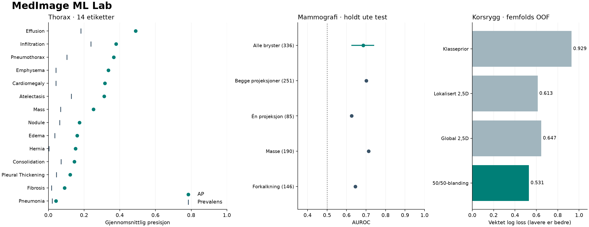

# Resultater

Resultatene gjelder tre forskjellige forskningsoppgaver og datasett.

## NIH ChestX-ray14 og CBIS-DDSM

| Testsett | Valgt modell | Antall | AUROC (95 % KI) | Gjennomsnittlig presisjon (95 % KI) | Brier før → etter |
| --- | --- | ---: | ---: | ---: | ---: |
| NIH ChestX-ray14 | `chest-global` | 25,596 | 0.779 (0.771–0.786) | 0.239 (0.228–0.252) | 0.0823 → 0.0592 |
| CBIS-DDSM | `mammo-global` | 336 | 0.686 (0.625–0.742) | 0.637 (0.567–0.712) | 0.2177 → 0.2180 |

Thorax bruker makrogjennomsnittet over 14 etiketter. Mammografi bruker én malignitetsvariabel. Intervallene bruker 400 trekk med tilbakelegging av hele pasientgrupper. Thoraxgrupper slår sammen pasient-ID-er som deler identiske bilder.

Brier-tapet måler gjennomsnittlig kvadratfeil for de predikerte sannsynlighetene. Sammenlign før og etter på hvert testsett for å se hvordan kalibreringen overføres fra valideringssettet.

### Valideringsforsøk

| Forsøk | Epoke | AUROC | Gjennomsnittlig presisjon | Trente epoker | Minutter | Maks reservert VRAM |
| --- | ---: | ---: | ---: | ---: | ---: | ---: |
| `chest-global` | 4 | 0.815 | 0.215 | 5 | 23.0 | 1.23 GiB |
| `chest-attention` | 4 | 0.815 | 0.214 | 7 | 32.4 | 1.24 GiB |
| `mammo-global` | 2 | 0.738 | 0.742 | 12 | 2.2 | 0.91 GiB |
| `mammo-attention` | 5 | 0.725 | 0.711 | 14 | 12.8 | 2.89 GiB |

### Etiketter og projeksjoner

| Thoraxetikett | Positive testbilder | AUROC | Gjennomsnittlig presisjon |
| --- | ---: | ---: | ---: |
| Atelectasis | 3,279 | 0.750 | 0.312 |
| Cardiomegaly | 1,069 | 0.867 | 0.317 |
| Effusion | 4,658 | 0.816 | 0.489 |
| Infiltration | 6,112 | 0.682 | 0.379 |
| Mass | 1,748 | 0.766 | 0.252 |
| Nodule | 1,623 | 0.693 | 0.174 |
| Pneumonia | 555 | 0.680 | 0.043 |
| Pneumothorax | 2,665 | 0.835 | 0.367 |
| Consolidation | 1,815 | 0.723 | 0.145 |
| Edema | 925 | 0.835 | 0.161 |
| Emphysema | 1,093 | 0.867 | 0.336 |
| Fibrosis | 435 | 0.786 | 0.090 |
| Pleural Thickening | 1,143 | 0.745 | 0.122 |
| Hernia | 86 | 0.856 | 0.153 |

## RSNA LumbarDISC

| Modell | Samlet OOF | Spinal | Foraminal | Subartikulær | Alvorlig spinal |
| --- | ---: | ---: | ---: | ---: | ---: |
| `prior` | 0.92947 | 0.80020 | 0.88889 | 1.07568 | 0.95310 |
| `localized` | 0.61268 | 0.47517 | 0.66740 | 0.73272 | 0.57543 |
| `global_reference` | 0.64654 | 0.55763 | 0.72677 | 0.81204 | 0.48973 |
| `equal_weight_blend` | 0.53069 | 0.40842 | 0.63264 | 0.69652 | 0.38517 |

### Foldresultater

| Modell | Fold 0 | Fold 1 | Fold 2 | Fold 3 | Fold 4 |
| --- | ---: | ---: | ---: | ---: | ---: |
| `prior` | 0.92903 | 0.92309 | 0.94359 | 0.92024 | 0.93122 |
| `localized` | 0.62298 | 0.63114 | 0.64273 | 0.59777 | 0.56836 |
| `global_reference` | 0.64696 | 0.62774 | 0.65868 | 0.65080 | 0.64871 |
| `equal_weight_blend` | 0.53890 | 0.52827 | 0.55223 | 0.51745 | 0.51634 |

95 % parvise bootstrapintervaller for endring i tap mot global referanse.

- `localized` -0.063–-0.005 og 4 av 5 bedre folder.
- `equal_weight_blend` -0.125–-0.106 og 5 av 5 bedre folder.

Valgt inferenskonfigurasjon er `equal_weight_blend`. Rå DICOM til CSV ble verifisert på 1 undersøkelse med 25 rader.

Medianen for landemerkeavvik var 7.32 mm, mot 16.19 mm for den statiske referansen. 67.6% av landemerkene lå innenfor 10 mm. 0.05% av primærutsnittene hadde manglende sekvens.

På fold 0 var tapet 0.62298 med estimerte koordinater og 0.56182 med tilgjengelige annoterte koordinater. Utforskende kalibrering på de lagrede OOF-prediksjonene ga 0.53624.
